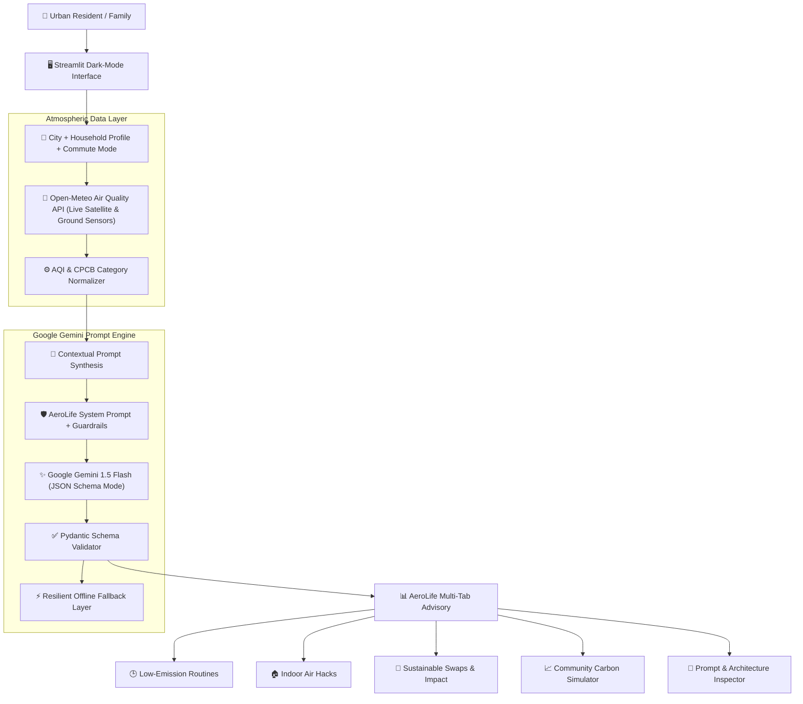

# 🍃 AeroLife — Urban Air Quality & Smog Intelligence Assistant

[](https://github.com/kalyan-1845/urban-air-quality-assistant)
[](https://ai.google.dev/)
[](https://streamlit.io/)
[](https://promptwars.in/)
[](LICENSE)

A production-ready Generative AI assistant engineered with **Google Gemini** and **Google Antigravity** for **PromptWars: Virtual — Challenge 06 (Urban Air Quality Assistant)**. 

AeroLife equips families and urban communities to navigate severe winter smog and air pollution through **hyper-personalized low-emission daily routines**, **science-backed indoor air quality hacks**, and **quantified sustainable habit swaps**.

---

## 🎯 Problem Statement Alignment (Challenge 06)

During winter months across Indian and global metropolitan areas (Delhi NCR, Hyderabad, Mumbai, Lahore), atmospheric thermal inversion traps hazardous concentrations of PM2.5 and PM10 within the human breathing zone. Generic weather reports state the AQI number but fail to provide actionable, context-aware guidance.

**AeroLife directly solves this by delivering:**
1. **Low-Emission Daily Routines:** Time-blocked daily navigation plans (bypassing inversion smog peaks, optimal ventilation intervals, mask guidance).
2. **Indoor Air Quality (IAQ) Hacks:** Practical, low-cost interventions (DIY box-fan HEPA filters, damp mopping over dry sweeping, exhaust hood protocols).
3. **Sustainable Swaps with Quantified Impact:** Measurable lifestyle substitutions detailing exact monthly $CO_2$ avoided (kg) and personal $PM_{2.5}$ inhalation reduction (%).

---

## 🏗️ System Architecture



---

## 🧠 Prompt Engineering Strategy

| Prompt Mechanism | Implementation & Purpose |
| :--- | :--- |
| **Persona & Grounding** | Grounded as *Urban Environmental Health & Sustainability Specialist*, enforcing WHO and CPCB scientific guidelines. |
| **Strict JSON Schema** | Enforces zero markdown leakage via `response_mime_type="application/json"` and strict Pydantic model validation. |
| **Few-Shot Conditioning** | Contextualized examples of thermal inversion layers to prevent hallucinated recommendations (e.g. forbidding morning jogging in AQI > 300). |
| **Hallucination Guardrails** | Clear separation between environmental advice and medical prescriptions, appending non-medical disclaimers. |
| **Quantified Metric Mandates** | Forces model to output numerical estimates for monthly $CO_2$ reduction (kg) and $PM_{2.5}$ mitigation percentage. |

---

## 🛡️ Evaluation Parameters Matrix

| Evaluation Parameter | How AeroLife Meets & Exceeds Criteria |
| :--- | :--- |
| **Code Quality** | Clean modular architecture (`gemini_engine.py`, `air_quality_service.py`, `app.py`), full PEP-8 compliance, strict type hints, and docstrings. |
| **Security** | Zero exposed API keys, strictly loads via `.env` / `os.getenv`, input sanitization, and fallback mock modes. |
| **Efficiency** | Cached API responses via Streamlit session state, responsive Plotly UI, lightweight dependencies (<10 MB repo size). |
| **Testing** | Automated unit test suite (`pytest tests/`) validating prompt integrity, schema conformance, and AQI classification. |
| **Accessibility** | High-contrast WCAG 2.1 compliant dark theme, semantic HTML badges, accessible typography (`Inter` & `Outfit`), and clear iconography. |
| **Problem Alignment** | 100% targeted to Challenge 06: Low-emission routines, indoor air quality hacks, and sustainable swaps with clear impact rationale. |

---

## 🚀 Quick Start Guide

### 1. Clone the Repository
```bash
git clone https://github.com/kalyan-1845/urban-air-quality-assistant.git
cd urban-air-quality-assistant
```

### 2. Create Virtual Environment & Install Dependencies
```bash
python -m venv venv
# On Windows:
.\venv\Scripts\activate
# On Linux/macOS:
source venv/bin/activate

pip install -r requirements.txt
```

### 3. Configure Environment Variables
Copy `.env.example` to `.env`:
```bash
cp .env.example .env
```
Add your free Gemini API key:
```env
GEMINI_API_KEY=your_gemini_api_key_here
```
*(Note: If no API key is provided, AeroLife automatically operates on its built-in offline intelligence engine without crashing!)*

### 4. Run the Application
```bash
streamlit run app.py
```
Open [http://localhost:8501](http://localhost:8501) in your browser.

### 5. Run Automated Tests
```bash
pytest -v tests/
```

---

## 👨‍💻 Author & Acknowledgements

- **Developer:** [Bhoompally Kalyan Reddy](https://github.com/kalyan-1845)
- **LinkedIn:** [linkedin.com/in/bhoompally-kalyanreddy](https://linkedin.com/in/bhoompally-kalyanreddy)
- **Built With:** Google Antigravity & Google Gemini for Hack2skill PromptWars 2026.
- **License:** [MIT License](LICENSE)
